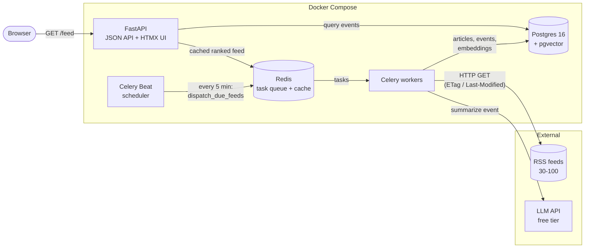
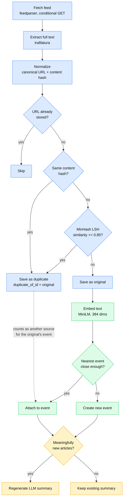

# Pulse architecture

## System overview

Everything inside the box runs in Docker Compose. The API and the workers never call each
other directly: they share state through Postgres (source of truth) and Redis (task queue
and cache).

## Article pipeline

What happens to each article a worker fetches. Colours show which week builds each step.

Legend: blue = Week 1 (ingest + dedupe), green = Week 2 (embeddings + clustering),
yellow = Week 3 (LLM summaries). Week 3 also adds ranking and caching on the read side
(API → Redis → Postgres in the overview).
