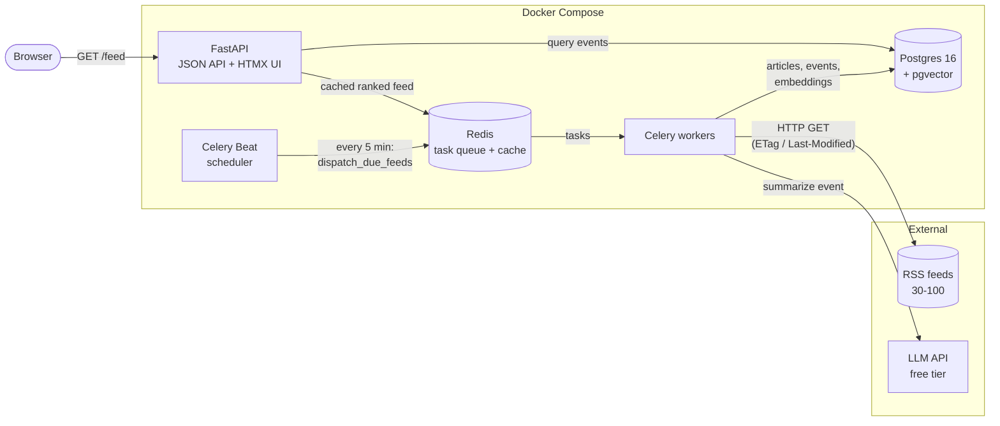
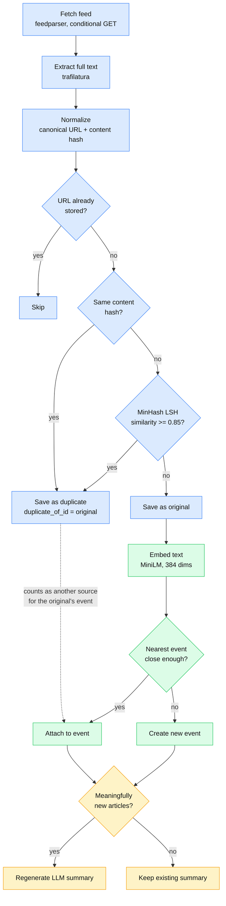

# Pulse architecture

## System overview

Everything inside the box runs in Docker Compose. The API and the workers never call each
other directly: they share state through Postgres (source of truth) and Redis (task queue
and cache).

## Article pipeline

What happens to each article a worker fetches. Colours show which week builds each step.

Legend: blue = Week 1 (ingest + dedupe), green = Week 2 (embeddings + clustering),
yellow = Week 3 (LLM summaries). Week 3 also adds ranking and caching on the read side
(API → Redis → Postgres in the overview).

## Design decisions

| Decision | Alternative rejected | Why |
|---|---|---|
| Store duplicates, linked to the original via `duplicate_of_id` | Delete them | "How many outlets ran this?" is a ranking signal; duplicates skip embedding/LLM so they cost little |
| `UNIQUE(canonical_url)` + `INSERT ... ON CONFLICT DO NOTHING` | Check "already stored?" in Python first | Two workers can both check, both see nothing, and both insert; the DB constraint can't be raced |
| Partial unique index: one original per `content_hash` (`WHERE duplicate_of_id IS NULL`), conflict-free insert with no target, one retry as a duplicate | Rely on the "find original by hash" lookup alone | Two workers saving the same wire story at once would both store an original and double-count coverage; the index makes that impossible and the retry turns the loser into a duplicate |
| Commit per article; save the feed's `etag` only after the loop | One commit per feed | An uncommitted original blocks other workers' inserts of the same text until commit; short transactions keep that wait tiny and avoid lock-order deadlocks. Saving `etag` last means a crash refetches the feed instead of skipping unsaved articles |
| Hash the article body, not the headline | Hash the headline | Outlets rewrite headlines on identical wire copy |
| Feed backoff state in Postgres (`consecutive_failures`, `next_fetch_at`) | Celery's built-in retry only | Survives restarts, visible to every worker and to a simple SQL query |
| Tests build the schema with the real Alembic migrations | `Base.metadata.create_all()` | A broken migration fails in tests, not on deploy day |
| One shared feed, no user accounts | Per-user personalised feeds | Accounts cost about a week and would block caching one ranked feed for everyone |
