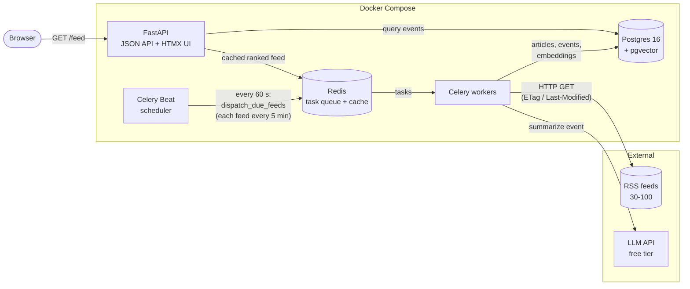
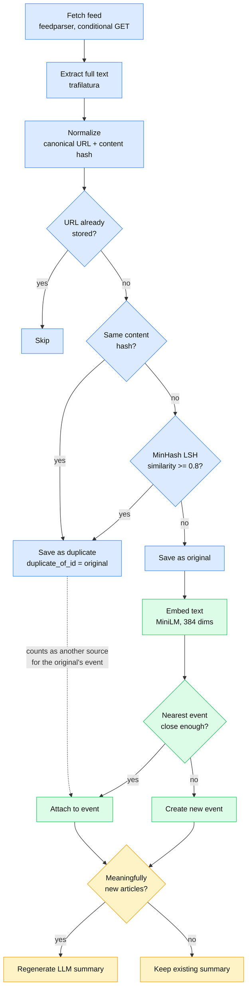

# Pulse architecture

## System overview

Everything inside the box runs in Docker Compose. The API and the workers never call each
other directly: they share state through Postgres (source of truth) and Redis (task queue
and cache).

## Article pipeline

What happens to each article a worker fetches. Colours show which week builds each step.

Legend: blue = Week 1 (ingest + dedupe), green = Week 2 (embeddings + clustering),
yellow = Week 3 (LLM summaries). Week 3 also adds ranking and caching on the read side
(API → Redis → Postgres in the overview).

## Design decisions

| Decision | Alternative rejected | Why |
|---|---|---|
| Store duplicates, linked to the original via `duplicate_of_id` | Delete them | "How many outlets ran this?" is a ranking signal; duplicates skip embedding/LLM so they cost little |
| `UNIQUE(canonical_url)` + `INSERT ... ON CONFLICT DO NOTHING` | Check "already stored?" in Python first | Two workers can both check, both see nothing, and both insert; the DB constraint can't be raced |
| Partial unique index: one original per `content_hash` (`WHERE duplicate_of_id IS NULL`), conflict-free insert with no target, one retry as a duplicate | Rely on the "find original by hash" lookup alone | Two workers saving the same wire story at once would both store an original and double-count coverage; the index makes that impossible and the retry turns the loser into a duplicate |
| Commit per article; save the feed's `etag` only after the loop | One commit per feed | An uncommitted original blocks other workers' inserts of the same text until commit; short transactions keep that wait tiny and avoid lock-order deadlocks. Saving `etag` last means a crash refetches the feed instead of skipping unsaved articles |
| Hash the article body, not the headline | Hash the headline | Outlets rewrite headlines on identical wire copy |
| Feed backoff state in Postgres (`consecutive_failures`, `next_fetch_at`) | Celery's built-in retry only | Survives restarts, visible to every worker and to a simple SQL query |
| Beat runs one dispatcher every 60 s; it claims due feeds with one `UPDATE ... RETURNING` that pushes `next_fetch_at` 15 min ahead (a lease) | One Beat entry per feed; or SELECT due feeds, then mark them | Feeds live in the DB, not in code. The lease stops the next tick queueing a feed that's still queued or running; if a worker dies, the lease expires and the feed is retried |
| `task_acks_late` + hard `task_time_limit` (10 min) shorter than the lease | Ack on receipt (Celery default) | A crashed fetch is recovered by its lease expiring (about 15 min later): a killed child process gets its task acked anyway (`task_reject_on_worker_lost` is off), and Redis only redelivers if the whole worker dies, after a 1 h visibility timeout. acks_late covers that whole-worker case; the time limit guarantees a fetch ends before its lease runs out. Rerunning is safe because ingest is idempotent |
| Tests build the schema with the real Alembic migrations | `Base.metadata.create_all()` | A broken migration fails in tests, not on deploy day |
| Near-dups: exact hash first, then MinHash + LSH over the last 3 days of originals, rebuilt in memory per fetch | Compare each new article with every stored one; or keep the LSH index in Redis | LSH checks only likely matches; a few thousand signatures load in well under a second, and Postgres stays the one copy of the truth |
| LSH tuned to 0.5 for candidates, every candidate verified at 0.8 | Tune LSH to 0.8 directly | At its tuning point LSH finds a match only about half the time; a looser LSH plus an exact check misses almost nothing |
| Near-dups reuse `duplicate_of_id` and always point at an original | A separate near-dup table or column | One rule for "this is a copy"; only originals are indexed, so no chains of copies of copies |
| Embeddings in a separate Celery task on its own queue, served by a 1-process `embedder` container | Embed inside the fetch task | The model loads once (~400 MB) instead of in each of 4 fetch processes; fetching stays fast, and a model problem can't stop fetching |
| Embed rows locked with `FOR NO KEY UPDATE SKIP LOCKED` | No lock, or plain `FOR UPDATE` | SKIP LOCKED: an overlapping run takes other rows instead of redoing these. NO KEY UPDATE: ingest can still insert a duplicate whose foreign key points at a locked row (checked: FOR UPDATE blocked it) |
| Beat's embed tick expires after 300 s | No expiry; or expiry = the 60 s interval | Ticks carry no data (pending rows are in Postgres), so dropping stale ones loses nothing and stops a pile-up after downtime. 300 not 60: expiry compares two machines' clocks, so it leaves room for drift |
| Embed and commit one article per transaction | Batches of 64 per commit | Measured on CPU: batching was only ~10% faster (0.52 s vs 0.58 s per 64), but one bad article rolled back the whole batch and needed a fallback path. Revisit with a GPU, where batching pays |
| No vector index on articles yet | HNSW index on `articles.embedding` now | No query searches articles by vector; an index without a query is only write cost |
| Incremental clustering: join the nearest recent event's centroid at cosine >= 0.75, else start an event | Re-cluster everything on a schedule (e.g. HDBSCAN) | Cost per article doesn't grow with the archive, and event ids stay stable. Trade-off: early mistakes aren't undone, and a long story can stay one event as its centroid drifts (100-article Nvidia story merged a resignation and a reinstatement) |
| Threshold 0.75, from reading real merges at 0.70/0.75/0.80 | 0.70 | Precision first: a wrong merge gives a misleading summary; a wrong split only shows a story twice. Formal precision/recall comes in phase 4 |
| Exact centroid search with a btree on `last_article_at` | HNSW index on centroids | Only recent events are scanned (548 rows, 1.2 ms total); an approximate index plus a WHERE filter can miss the best match |
| Clustering serialised by `pg_advisory_xact_lock`, one article per transaction | Row locks | Two runs could both create an event for one story, and a row that doesn't exist yet can't be locked. Released automatically at commit/rollback |
| Two-sided 3-day window; article time capped at `fetched_at` | Lower bound only, trusting feed dates | Real data: 9 Nov articles had joined an 18 Nov event; a future typo would keep an event open for years |
| One shared feed, no user accounts | Per-user personalised feeds | Accounts cost about a week and would block caching one ranked feed for everyone |
